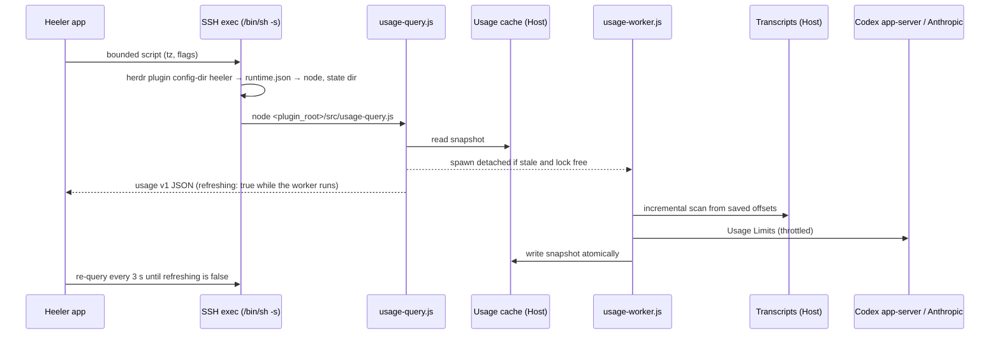

# Agent Usage

Status: Proposed. Not implemented. Decisions are recorded in
[ADR 0026](../adr/0026-plugin-collects-agent-usage-on-the-host.md); terms are
defined in [CONTEXT.md](../../CONTEXT.md) (**Usage Limits**, **Token Usage**,
**Transcript**).

## Summary

Heeler shows, per Host, how much of each Claude Code and Codex account's
Usage Limits is used and when each window resets, beside the Token Usage those
programs recorded on the Host over the last 30 days with an estimated API cost.

All collection happens on the Host inside the Heeler herdr plugin. The plugin
reads Transcripts locally, asks the services for Usage Limits with the
credentials the programs already keep on the Host, and answers the app with a
small, filtered JSON document. The app reaches the plugin with one bounded SSH
exec per query. No SFTP, no new port, no credential ever leaves the Host, and
the user installs nothing beyond the plugin.

## Goals

- Usage Limits for Claude Code and Codex: each window's used percentage and
  reset time, with the source and age of the reading.
- Token Usage for Claude Code and Codex: today, the last 7 days and the last
  30 days; a 30-day daily series; a per-model split; the top 10 working
  directories over 30 days. Each with an estimated API cost where the model is
  priced.
- Correct counting: no double counting of repeated, copied, replayed or
  cumulative records.
- Fast queries over SSH: a query never waits for a log scan or a network call.

## Non-goals

- Usage per Agent or per session (later).
- Usage across Hosts, on the Console, or on Agent detail (later).
- History beyond 30 days. The plugin keeps no history of its own; what it
  shows is bounded by the Transcripts still on the Host.
- A local estimate of a rolling 5-hour window. Windows come only from Usage
  Limits, so a local guess is never mistaken for the account's real limit.
- Billing. The estimated cost is what the tokens would cost at API list
  prices; it is not a subscription invoice or a credit balance.
- Native Windows Hosts. The plugin supports Linux and macOS only.
- Agent programs other than Claude Code and Codex.
- Codex limit groups other than the default one. Codex can report several
  limit groups (`rateLimitsByLimitId`); the first version shows only the
  default group's two windows and says so on the Usage page.

## Architecture



### Components on the Host

| Component | Runs in | Role |
| --- | --- | --- |
| Runtime recorder (in the existing startup hook) | herdr's environment | Writes `runtime.json` to the plugin config directory |
| `src/usage-query.js` | the app's SSH exec | Reads the cache, spawns the worker when needed, prints the contract |
| `src/usage-worker.js` | detached from the query | Scans Transcripts, reads Usage Limits, writes the cache |
| `src/usage/claude-*.js`, `src/usage/codex-*.js` | worker | Per-program Transcript scanners and limit readers |
| `src/usage/pricing.json` | worker | Bundled, versioned price table |

### Why the runtime file exists

herdr runs the plugin with its own environment; the app's SSH exec has a
different, non-login one. Agents read `CLAUDE_CONFIG_DIR`, `CODEX_HOME` and
`XDG_CONFIG_HOME` from herdr's environment, and `node` may only be on herdr's
`PATH` (nvm, fnm, volta, or a Herdr Endpoint launcher with no `PATH` at all).
The startup hook runs in herdr's environment, so it records:

```json
{
  "version": 1,
  "recordedAt": "2026-10-23T12:00:00Z",
  "node": "/Users/u/.nvm/versions/node/v22.11.0/bin/node",
  "codex": "/opt/homebrew/bin/codex",
  "env": {
    "CLAUDE_CONFIG_DIR": null,
    "CODEX_HOME": null,
    "XDG_CONFIG_HOME": null
  },
  "stateDir": "/Users/u/.local/state/herdr/plugins/heeler"
}
```

- `node` is `process.execPath`; `codex` is the first executable `codex` on
  herdr's `PATH`, or `null`.
- `stateDir` is `HERDR_PLUGIN_STATE_DIR`, which herdr provides to plugin
  commands. The usage cache lives in `<stateDir>/usage/`. This reuses herdr's
  per-instance isolation: a Herdr Endpoint runs with its own
  `XDG_STATE_HOME`, so it never shares a cache with the user's own herdr,
  whose Agents may read different `CLAUDE_CONFIG_DIR` or `CODEX_HOME` roots.
- The file is written atomically (temp file and rename), mode 0600, and holds
  no secret.
- When the file is missing (plugin just installed, herdr not restarted since),
  the query cannot know the state directory or the right roots, so it does not
  guess: the script reports `runtime: "missing"`, no worker runs, and the app
  asks the user to restart herdr once.

## App to plugin channel

One query is one `runBoundedScript` exec (`/bin/sh -s`, remote watchdog,
ordinary-session channel, never cancelled once dispatched), with a 10-second
deadline and a 1 MiB `head -c` cap on output. The script, fixed text from the
app with only validated arguments interpolated:

1. Exports `HerdrHostPath.pathExport` (or uses the Host's Herdr Endpoint
   launcher) and runs `herdr plugin config-dir heeler`.
2. Reads `runtime.json` from that directory. When it is missing, prints the
   `runtime: "missing"` result and stops.
3. Runs `<runtime.node> <plugin_root>/src/usage-query.js --tz <IANA>
   [--claude-limits]` and prints its stdout between nonce markers.

`plugin_root` comes from `plugin.list`; the app's `PluginListResult` decoder
gains `plugin_root`. The time zone is validated against the device's IANA
identifier set before interpolation. A recorded `node` that no longer runs
(exit 126 or 127) maps to a "restart herdr" state, since the next startup
records the current one.

`plugin.action.invoke` was rejected: it is asynchronous (stdout only via
polling `plugin.log.list`), its log output is capped, and every action is
visible in the user's herdr command palette.

## Token Usage

### Sources

- **Claude Code**: every `*.jsonl` under `projects/` of each root:
  `CLAUDE_CONFIG_DIR` split on `,` (each entry either a config directory with
  `projects/` or the `projects/` directory itself), else
  `${XDG_CONFIG_HOME:-~/.config}/claude` and `~/.claude`, deduplicated by real
  path. This includes subagent and workflow files under
  `<project>/<session>/subagents/`.
- **Codex**: `${CODEX_HOME:-~/.codex}/sessions/YYYY/MM/DD/rollout-*.jsonl`
  and `archived_sessions/`. Plain files win over `.jsonl.zst`, `sessions/`
  over `archived_sessions/`. `.zst` files are read only when the running Node
  has `zlib.zstdDecompressSync`; otherwise they are counted in
  `scan.skippedArchives` and the app says so.

Multiple roots per program are merged into one total for that program.

### Counting rules: Claude Code

The record shapes are documented in
[Claude Code transcripts](../research/claude-code-transcript-format.md).

- Count `type: "assistant"` records with `message.usage`; skip
  `message.model == "<synthetic>"`.
- One API response is written as several records that share `message.id`
  and `requestId` and repeat `usage`. Claude Code also copies responses into
  other transcripts. Deduplicate globally (across files and sessions) on
  `message.id + requestId`; without `requestId`, on
  `message.id + sessionId + timestamp`.
- On collision keep, in order: the non-sidechain record, the larger token
  total, the record carrying `speed`.
- Drop sidechain replays that re-copy a parent message: same `message.id` in
  the same session with a different `requestId`.
- Count advisor iterations (`usage.iterations[type == "advisor_message"]`)
  under their own model.
- Cache writes are `cache_creation.ephemeral_5m_input_tokens` and
  `ephemeral_1h_input_tokens`; when the split is missing, all of
  `cache_creation_input_tokens` is treated as 5-minute writes.
- Directory: the session's `cwd`, else the decoded project directory name.

### Counting rules: Codex

The record shapes are documented in
[Codex rollouts](../research/codex-rollout-format.md).

- Usage comes from `event_msg` `token_count` with `info`. If
  `total_token_usage` equals the previous event's, skip it as a duplicate.
  Otherwise the delta is `last_token_usage`, or the total minus the previous
  total when `last_token_usage` is absent. Drop all-zero deltas.
- The model is the latest `turn_context.model`; the service tier comes from
  `thread_settings_applied` (priority or fast means Fast pricing).
- Forks (`session_meta.forked_from_id`): the child's leading usage that
  replays the parent up to the fork time is excluded by matching against the
  parent; when the parent is missing, skip the leading burst of events no
  more than 1000 ms apart.
- Multi-agent children replay parent history: count only usage after the
  `inter_agent_communication_metadata` (or `inter_agent_communication`)
  marker with `trigger_turn: true`. Detect by markers, never by
  `cli_version`.
- Compaction: a response that compacts the thread is written as a top-level
  `token_usage_record` (`response_id`, `usage`, optionally
  `thread_token_usage`) and later confirmed by
  `compacted.payload.compaction_response_id`. Whether a `token_count` also
  counts it depends on the kind of compaction, so each response is counted
  exactly once:
  - Local compaction writes an advancing `token_count` between the record and
    its marker. When such an advance follows the latest pending record and its
    delta equals the record's `usage`, or its new total equals the record's
    `thread_token_usage`, the `token_count` has counted the response; the
    record is marked counted and is never added.
  - Remote compaction writes no advance. The pending record is added once
    when its `compacted` marker arrives (or immediately if the marker came
    first).
  - A record never confirmed by a marker is not counted; a response id is
    counted at most once per session.
  - A fixture covers both orders: record, advancing `token_count`, marker
    (counted once by `token_count`); and record, marker with no advance
    (counted once by the record).
- Directory: `session_meta.cwd`.

### Normalized tokens

Both programs map to one shape:

| Field | Claude Code | Codex |
| --- | --- | --- |
| `input` | `input_tokens` | `input_tokens - cached_input_tokens` |
| `cacheRead` | `cache_read_input_tokens` | `cached_input_tokens` |
| `cacheWrite` | 5m + 1h cache creation | `cache_write_input_tokens` (0 when absent) |
| `output` | `output_tokens` | `output_tokens` (includes reasoning) |
| `reasoning` | 0 | `reasoning_output_tokens`, informative, not added to `total` |
| `total` | input + cacheRead + cacheWrite + output | same |

### Estimated cost

`src/usage/pricing.json` is generated by `scripts/generate-usage-pricing.mjs`
from a public model pricing dataset (its source URL lives in the script),
trimmed to Claude and GPT model families, reviewed as a diff, and regenerated
before each plugin release. It carries a `pricingVersion` date. The plugin
never fetches prices at runtime.

Each model entry carries input, output, cache read and cache write
(5-minute) rates, a Fast multiplier, and an optional `longContext` tier: an
input threshold with its own full rate set. Cost is computed **per request**
when the request is scanned, then added to its bucket, because tiers depend
on one request's size:

- A request's context is `input + cacheRead + cacheWrite`. When the model has
  a `longContext` tier and the context exceeds its threshold, every token of
  that request (input, cache read, cache write, output) uses the tier's rates;
  otherwise every token uses the base rates. Never split one request across
  tiers. Models priced flat across their whole window carry no tier.
- Claude: `input × input + cacheRead × cacheRead + write5m × cacheWrite +
  write1h × (input × 2) + output × output`, with the rates of the chosen tier.
- Codex: `input × input + cacheRead × (cacheRead, else input) + output ×
  output`; reasoning is already inside output. Fast service tier multiplies
  the request by the model's Fast multiplier.
- A model with no price adds its tokens to `unpricedTokens` and nothing to
  cost; it is reported with `priced: false` and `estimatedCostUSD: null`,
  never 0.

### Buckets, window and cache

- Usage is aggregated into 15-minute UTC buckets per program × model, plus
  per program × directory, each holding normalized tokens, estimated cost and
  unpriced tokens. 15 minutes makes any IANA offset (+5:30, +5:45) exact when
  the query folds buckets into the device's calendar days.
- The window is the last 30 days. Older buckets and dedupe keys are pruned on
  every worker run. The plugin keeps no history of its own: when a Transcript
  is deleted (Claude Code removes them after `cleanupPeriodDays`, 30 by
  default) its usage leaves the cache with the rebuild that deletion
  triggers, and `scan.coveredFrom` reports the earliest day actually covered.
- The cache directory (`<stateDir>/usage/`) holds:
  - `files.json`: per file `{dev, ino, size, mtimeMs, offset, carry}` where
    `carry` is per-file parser state (previous Codex total, current model,
    fork and pending-compaction state).
  - `buckets.json`: the 30-day buckets.
  - `keys.json`: Claude and Codex dedupe keys seen in the window.
  - `limits.json`: the last Usage Limits readings (percentages, reset times,
    errors, `nextAllowedAt`); never credentials.
  - `worker.lock`: `O_EXCL` lockfile with pid and start time; stale after 10
    minutes or when the pid is gone.
- Appends stay incremental: a file whose `dev/ino` match and whose size grew
  (same or newer `mtimeMs`) is read from `offset` up to the last complete
  line; a partial last line is left for the next run.
- Anything else rebuilds the whole cache from the Transcripts: a file that was
  deleted, shrank, changed inode, or changed `mtimeMs` without growing. Global
  deduplication means a record skipped in one file may have been counted from
  another, so removing one file's share cannot be done locally; a rebuild is
  slower but always correct. The rebuild runs in the background like a first
  scan, and the previous snapshot is served, marked `refreshing`, until it
  finishes. Files that newly fall outside the 30-day window are pruned by
  bucket age, which needs no rebuild.
- Deleting the cache directory is always safe: the next query starts a full
  rebuild.

### Worker scheduling

- The query spawns the worker (detached, `stdio: "ignore"`, `nice` where
  available) when the cache is older than 60 seconds, a rebuild is pending,
  or Usage Limits are due, and the lock is free.
- One worker run is one refresh: scan (incremental or rebuild), then Usage
  Limits. The query reports `refreshing: true` from the moment it spawns the
  worker, or finds it running, until the run has written its final snapshot,
  so the app keeps polling through the limit requests too.
- A full scan processes files newest first, so the recent days fill in first;
  `scan.state` is `partial` until every file in the window is done, then
  `complete`.
- The worker writes the cache atomically after each batch of files, so a
  query mid-scan returns partial, correctly labeled data.
- Files whose `mtime` is older than the window are skipped without reading.

## Usage Limits

### Codex

1. **Primary:** `codex -s read-only -a never app-server` over stdio JSON-RPC,
   using the `codex` recorded in `runtime.json`:
   `initialize` → `initialized` → `account/read` →
   `account/rateLimits/read` with no params, so older Codex versions that do
   not know newer optional params still answer. The process is killed after
   the response or 8 seconds. Codex owns its credentials and their refresh;
   the plugin never reads `auth.json`. Only the response's default
   `rateLimits` group is used (its `primary` and `secondary` windows).
2. **Fallback:** when `codex` is missing, the method is unknown (older
   Codex), or the account is not signed in with ChatGPT, use the newest
   `token_count.rate_limits` seen during the scan, reported with
   `source: "lastSession"` and its `observedAt`.

A window whose `resetsAt` has passed, from either source, is reported with
`expired: true` and `usedPercent: null`. The app shows it as expired, current
usage unknown, and never infers the new window's usage.

The plugin does not call the ChatGPT web backend directly.

### Claude Code

Off unless the app passes `--claude-limits` (the per-Host toggle).

- Credentials are read, never written, cached, logged or forwarded:
  `$CLAUDE_CONFIG_DIR/.credentials.json`, then `~/.claude/.credentials.json`,
  then on macOS a non-interactive
  `security find-generic-password -s "Claude Code-credentials" -w`, whose
  failure (locked or ACL-protected keychain over SSH) is a normal outcome.
- Only `claudeAiOauth` entries whose scopes include `user:profile` are used.
- `GET https://api.anthropic.com/api/oauth/usage` with `Authorization: Bearer
  …` and `anthropic-beta: oauth-2025-04-20`. The token is passed in the
  request header from memory, never on a command line or in a file the plugin
  writes.
- The plugin never refreshes the token. Claude Code's refresh tokens likely
  rotate, and a refresh by anyone else could sign Claude Code out. An expired
  token yields `reason: "expired"`, and the app says to open Claude Code on
  the computer.
- Windows read: `five_hour`, `seven_day`, `seven_day_opus`,
  `seven_day_sonnet`, and any other `{utilization, resets_at}` object, plus
  `extra_usage` when enabled.
- Throttle: at most one request per 60 seconds; 429 honors `Retry-After`
  (default 5 minutes) through `limits.json`'s `nextAllowedAt`.

> [!WARNING]
> Anthropic's terms say OAuth sign-in is for ordinary use of Claude Code and
> that developers "may not collect, store, or intermediate Claude.ai
> credentials or session tokens". The endpoint is undocumented. This is why
> Claude Usage Limits are opt-in per Host, credentials never leave the Host,
> and the toggle's explanation names the risk. Revisit before release.

## Contract: `usage` v1

The query prints exactly one JSON object. Unknown fields are ignored by the
app; a `version` with an unknown major tells the user to update Heeler. A
shared vector at `plugin/test-vectors/usage-v1.json` is produced by the Node
tests and decoded by the Swift tests.

```json
{
  "version": 1,
  "generatedAt": "2026-10-23T12:34:56Z",
  "timeZone": "Asia/Shanghai",
  "runtime": "recorded",
  "refreshing": false,
  "pricingVersion": "2026-10-20",
  "scan": {
    "state": "complete",
    "coveredFrom": "2026-09-24",
    "coveredThrough": "2026-10-23T12:34:00Z",
    "skippedArchives": 0
  },
  "programs": [
    {
      "program": "claude",
      "tokenUsage": {
        "state": "ok",
        "totals": {
          "today": {
            "tokens": { "input": 1200, "cacheRead": 830000, "cacheWrite": 41000, "output": 9800, "reasoning": 0, "total": 882000 },
            "estimatedCostUSD": 1.92,
            "unpricedTokens": 0
          },
          "last7Days": { "tokens": { "...": 0 }, "estimatedCostUSD": 12.4, "unpricedTokens": 0 },
          "last30Days": { "tokens": { "...": 0 }, "estimatedCostUSD": 51.0, "unpricedTokens": 0 }
        },
        "daily": [
          { "date": "2026-10-23", "tokens": { "...": 0 }, "estimatedCostUSD": 1.92 }
        ],
        "models": [
          { "model": "claude-opus-4-5", "priced": true, "tokens": { "...": 0 }, "estimatedCostUSD": 40.1 }
        ],
        "directories": [
          { "path": "/Users/u/src/app", "tokens": { "...": 0 }, "estimatedCostUSD": 22.3 }
        ]
      },
      "usageLimits": {
        "state": "disabled"
      }
    },
    {
      "program": "codex",
      "tokenUsage": { "state": "ok", "...": "same shape as above" },
      "usageLimits": {
        "state": "ok",
        "source": "service",
        "observedAt": "2026-10-23T12:34:50Z",
        "plan": "plus",
        "windows": [
          { "id": "primary", "durationMinutes": 300, "usedPercent": 42, "resetsAt": "2026-10-23T15:00:00Z", "expired": false },
          { "id": "secondary", "durationMinutes": 10080, "usedPercent": 18, "resetsAt": "2026-10-28T00:00:00Z", "expired": false }
        ]
      }
    }
  ]
}
```

- `runtime`: `recorded`, or `missing` (no `runtime.json`; the result carries
  nothing else).
- `refreshing`: true while a worker run (scan and Usage Limits) is in
  progress, including the run this query just started.
- `scan.state`: `partial` (a full scan or rebuild has not reached every file
  in the window yet) or `complete`.
- `tokenUsage.state`: `ok`, `noData` (program never used on this Host),
  `error` with `reason`.
- `usageLimits.state`: `ok`, `disabled` (Claude toggle off), `unavailable`
  with `reason` (`programMissing`, `notSignedIn`, `apiKeyAccount`,
  `unsupportedCredential`, `expired`, `credentialUnreadable`), `throttled`
  with `retryAt` and the last good reading if any, `error` with `reason`.
- `source`: `service` (live reading) or `lastSession` (Codex rollout
  snapshot).
- A window with `expired: true` has `usedPercent: null`: its reading is from
  before `resetsAt`, and the current window's usage is unknown.
- Window `id`s: Claude `fiveHour`, `sevenDay`, `sevenDayOpus`,
  `sevenDaySonnet`, others as `claude:<key>`; Codex `primary`, `secondary` of
  the default limit group only.
  The app labels known ids and falls back to `durationMinutes` ("5-hour",
  "Weekly") for unknown ones.
- `daily` always has one entry per day in the window, zero-filled.
- `directories` holds at most 10 entries over 30 days, by total tokens.
- Never present: prompts, outputs, session titles, file contents, account
  emails, tokens or credential paths.

## App

- **Feature gate:** `HeelerPluginFeature.usage` with the minimum version of
  the plugin release that ships it (0.7.0 planned). Older plugins show the
  feature's requirement note; native Windows Hosts show "Not supported on
  Windows" as other plugin features do.
- **Transport:** `Transport.readAgentUsage(timeZone:claudeLimits:)` returning a
  decoded `AgentUsageReport`; POSIX only via `requirePOSIXHost`.
- **State:** an `AgentUsageStore` per Host owns the report, its freshness, and
  the refreshing re-query loop.
- **Toggle:** "Claude Code limits" per Host, stored on the device, default
  off, with an explanation that the plugin uses Claude Code's sign-in on the
  computer to ask Anthropic for limits, that the sign-in never leaves the
  computer, and that this use is not officially supported.
- **Surfaces:**
  - Host detail gains a Usage section: per program, a bar for each Usage
    Limits window with its reset time and source age; below, today and 30-day
    Token Usage with estimated cost.
  - Tapping it opens the Usage page: today / 7 days / 30 days totals, a 30-day
    daily chart, per-model split, top 10 directories, the coverage note
    (`coveredFrom`, skipped archives), the price table date, and a note that
    Codex shows its default limit group only.
- **Refresh:** query when the section or page appears, on pull to refresh, and
  every 3 seconds while `refreshing` is true, which covers the scan and the
  Usage Limits requests; polling stops when it turns false. One "Refreshing"
  indicator covers the whole run. No timers otherwise.
- **Copy rules:** cost is always "Estimated API cost"; Token Usage never
  claims to be the account's usage; a `lastSession` reading shows "as of
  <time>"; an expired window shows "Expired · current usage unknown"; no other
  product names.

## Security and privacy

- Credentials stay on the Host, in memory of one worker run, sent only to the
  service that issued them.
- Nothing is sent anywhere for Token Usage; the plugin reads local files only.
- The app receives aggregates and directory paths, which it can already see
  through the Agent's `cwd`.
- The cache holds token counts, model names, directory paths and limit
  percentages, under the plugin's state directory with 0700 permissions.

## Failure modes

| Situation | Result |
| --- | --- |
| Plugin missing or older than the feature | Requirement note, no exec |
| Native Windows Host | "Not supported on Windows" |
| `runtime.json` missing | `runtime: "missing"`; the app asks the user to restart herdr once |
| Recorded `node` no longer runs | Same restart-herdr state |
| First scan or rebuild in progress | Partial data, "Refreshing", 3-second re-query |
| Transcript deleted, truncated or replaced | Background rebuild; previous snapshot shown meanwhile |
| Worker crashed | Stale lock reclaimed; next query restarts it |
| Codex too old for `account/rateLimits/read` | `lastSession` fallback |
| Reset time of a reading has passed | Window shown expired, usage unknown |
| Claude token expired | "Open Claude Code on the computer to refresh its sign-in" |
| 429 from Anthropic | `throttled` with last good reading |
| Unknown model | Tokens shown, cost marked unpriced |
| Query exceeds 10 s | Bounded-script timeout; shown as a failed request |

## Testing

- **Plugin (`npm test`):** fixture Transcripts for duplicate Claude records,
  sidechain replays, advisor iterations, Codex duplicate totals, missing
  `last_token_usage`, forks with and without parent, multi-agent replay;
  compaction counted once both when a `token_count` advance precedes the
  marker and when none does; incremental append and partial line; rebuild on
  truncation, inode change and deletion, including a record duplicated in two
  files where the counted copy's file is deleted; bucket folding into +5:45
  and DST days; per-request long-context pricing just below and above a
  threshold, flat-priced models and unpriced models; limit readers against a
  stub app-server (no params sent) and a stub HTTP server, including 429,
  expired tokens and readings past their reset time; `refreshing` staying true
  until the limit requests finish; the shared `usage-v1.json` vector.
- **App:** decoding the shared vector, unknown fields and window ids, feature
  gating, store re-query loop, toggle plumbing, and the bounded script's
  quoting.
- **Real Host:** the Linux/field lane runs the query against a seeded
  `CLAUDE_CONFIG_DIR` and `CODEX_HOME`.

## Rollout

1. Plugin: runtime recorder, scanners, worker, query, pricing generator,
   tests; bump the plugin version and the shared plugin version vector.
2. App: decoder (`plugin_root`), transport method, store, Host detail section,
   Usage page; regenerate `Heeler.xcodeproj` for new sources.
3. Docs: `CHANGELOG.md` Unreleased entry; plugin README section on Usage and
   the Claude toggle; source map row in `docs/agents/navigation.md`.

## Open questions

- That startup hooks receive `HERDR_PLUGIN_STATE_DIR` on every supported
  herdr version: the plugin's tests and a real-Host check pin it.
- Minimum Codex version with `account/rateLimits/read`, and whether the
  `initialized` notification is required: feature-detect, verify on a real
  Host.
- Whether `security` can read the Claude Code keychain item from an SSH
  session on an unlocked Mac: verify; the file path covers locked keychains.
- The exact Node version that ships `zlib.zstdDecompressSync`: feature-detect.
- Anthropic's position on the usage endpoint: re-check the terms before
  shipping the Claude toggle.
